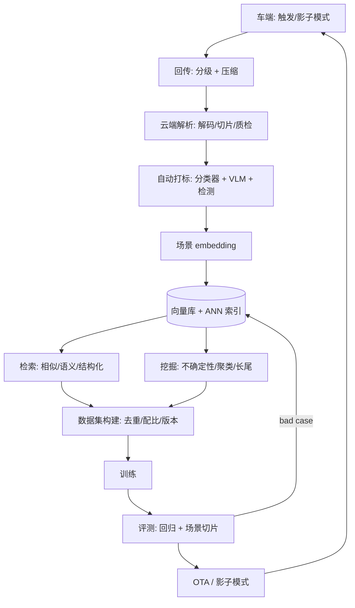

# 数据引擎与场景检索

> 一句话导读：**特斯拉数据引擎的真正魔法不是"采集"，而是"检索"**——发现一个 corner case 后，能从 PB 级数据里自动捞出"一千个相似场景"一起训练。本篇讲透数据闭环里最被低估的模型能力：**场景怎么变成向量、相似怎么在亿级规模上算、不确定性怎么当"困难样本探测器"、主动学习怎么选样本**。

---

## 🧭 本篇导读

| 项目 | 内容 |
|------|------|
| **这篇学什么** | 场景 embedding 的四种表示、ANN 检索（IVF/PQ/HNSW）与工程权衡、文本语义检索（CLIP）、不确定性的四种度量与坑、主动学习四大采样策略、去重聚类与长尾发现、数据配比、数据引擎整体架构 |
| **需要的前置知识** | [[数据挖掘与自动标注]]（挖掘四策略入门）、[[数据闭环总览]]（闭环框架）、[[计算机视觉基础]]（特征与分类）、[[Transformer架构详解]]（对比学习/CLIP 基础）|
| **学完之后你能** | ① 设计"一个 bad case → 检索相似场景"的完整链路；② 说清 IVF/PQ/HNSW 的取舍并算清内存；③ 选对不确定性度量并解释为什么 softmax 置信度不可靠；④ 说出主动学习四大策略的适用场景与冷启动办法 |
| **预计阅读时间** | 60-90 分钟 |

> [!tip] 怎么读这篇
> 本篇是 [[数据挖掘与自动标注]] 第一节的**工程深挖**。读的时候抓一条主线：**"模型不会的地方"怎么被自动发现（不确定性/聚类）→ 怎么被批量找出来（检索）→ 怎么被优先标注（主动学习）**。这三步就是数据引擎的全部。

---

## 〇、大白话：数据引擎 = "把一次偶遇变成一千次训练"

```
传统做法：路测碰到一次"货车掉落纸箱" → 标这一帧 → 训一次 → 下次碰到还是不会
数据引擎：碰到一次 → 用它的"场景指纹"去全库检索 → 捞出 800 个相似场景（不同天气/路口/角度）
        → 一起标、一起训 → 这一类场景一次性学会
```

> [!note] 一个比喻：从"通缉令"到"人脸识别"
> 传统挖掘像**发通缉令**：只能抓"长得一模一样的"（同一条路、同一个角度）。
> 数据引擎像**人脸识别**：抓的是"本质特征相似"的（换条路、换个角度、换个天气，还是同一种危险场景）。
> **"相似"的定义决定了数据引擎的上限**——用像素相似只能找到同款，用语义/行为相似才能找到同类。

**为什么这件事值得单独做模型**：因为**长尾场景的"类"是开放的**。你无法穷举"所有危险场景"的规则，但你可以回答"**还有哪些场景和这个危险场景很像**"——这是检索问题，不是分类问题。

---

## 一、场景表示：先把"场景"变成可计算的向量

### 1.1 四种 embedding，对应四种"相似"

| 表示 | 怎么得到 | 相似的含义 | 适合找什么 |
|------|----------|------------|------------|
| **图像/视频特征** | 预训练 backbone（DINOv2、CLIP 图像塔）池化 | 视觉上像 | 同类天气/道路/目标外观 |
| **BEV 特征** | BEV 模型中间层全局池化 | 空间布局像 | 同类型路口/车流结构（[[BEV感知全景]]）|
| **轨迹/行为特征** | 自车轨迹、他车轨迹编码 | 行为模式像 | 加塞/急刹/鬼探头等**行为类**场景 |
| **标签向量** | 多标签分类器输出（天气/道路/目标计数） | 属性组合像 | 结构化筛选（"雨天 + 施工 + 非机动车多"）|

> [!note] 为什么"轨迹特征"常被忽略但很重要
> 视觉相似 ≠ 危险相似。**两个路口的画面可能完全不同，但"自车被迫急刹 + 右侧电动车横穿"的行为模式是一样的**——这类场景用图像 embedding 检索根本捞不出来。**行为/轨迹 embedding 是"危险场景检索"的专用武器。**

### 1.2 从特征到"指纹"：池化与降维

```python
import numpy as np
from sklearn.decomposition import PCA

# 1. 逐帧特征 [T, C] → 场景级向量（时间池化）
def scene_embedding(frame_feats):
    # 均值池化：捕捉"整体氛围"；最大池化：捕捉"显著目标"
    mean_pool = frame_feats.mean(axis=0)
    max_pool = frame_feats.max(axis=0)
    return np.concatenate([mean_pool, max_pool])   # [2C]

# 2. 降维 + L2 归一化（检索前必做）
def compress(emb, pca):
    z = pca.transform(emb)          # 例如 768 → 256
    return z / np.linalg.norm(z, axis=-1, keepdims=True)  # 归一化后内积=余弦相似度
```

> [!warning] 池化的两个坑
> ① **均值池化会"稀释"小目标**：画面里 95% 是天空和路面，一辆远处的小车只占几十个像素——均值后几乎消失。**用最大池化或多尺度注意力池化**补。
> ② **场景切分粒度**：一段 30 秒视频压成一个向量，会丢掉"第 12 秒突然窜出一个人"——**通常按 2-5 秒切片（clip）做 embedding**，而不是整段。

---

## 二、相似检索：亿级规模怎么算

### 2.1 先算一笔账（面试常考）

```
1 亿个 clip × 512 维 × float32(4 字节) = 204.8 GB
暴力检索一次：1 亿次 × 512 维内积 ≈ 5×10^10 次乘加 → 单卡几十毫秒到几百毫秒
→ 内存放不下、延迟不可接受 → 必须用 ANN（近似最近邻）
```

### 2.2 三种主流 ANN 索引

| 索引 | 原理（一句话） | 优点 | 缺点 | 适用 |
|------|----------------|------|------|------|
| **IVF**（倒排） | 先 k-means 聚成 N 个桶，查询只扫最近的几个桶 | 实现简单、召回可调（nprobe） | 桶边界附近会漏；需要训练聚类 | 亿级、内存尚可 |
| **PQ**（乘积量化） | 把 512 维切成 64 段，每段用 256 个码字量化 → 64 字节/向量 | 内存压缩 32 倍（204GB→6.4GB） | 有量化误差，需精排补偿 | 内存受限的超大规模 |
| **HNSW**（图） | 多层近邻图，从粗到细"跳"到目标 | 召回高、延迟低（亚毫秒） | 内存占用大（要存图）、更新贵 | 十亿级、低延迟在线检索 |

> [!note] 工程上的标准答案是"组合"
> **IVF-PQ 做粗筛（省内存）→ 取出 top-1000 → 用原始向量精排（保精度）**。FAISS 的 `IndexIVFPQ` 就是为这个场景设计的；HNSW 适合"数据量中等但要求毫秒级"的场景。**面试能说出"两级检索：粗筛 + 精排"，说明你懂工程权衡。**

### 2.3 检索质量怎么评估

| 指标 | 含义 |
|------|------|
| **Recall@K** | 真正的相似场景有多少落在 top-K 里 |
| **mAP@K** | 排序质量（相似的是否排前面） |
| **查准率（人工核）** | 捞回来 100 个，几个人工认可"确实相似" |

> [!warning] 最容易被忽略的一步：**离线评估检索本身**
> 大多数团队直接上线检索、凭感觉调参。正确做法是**人工标 200 个 query 的"标准相似集"**，量化 Recall@K——否则你永远不知道"捞不到相似场景"是检索不行还是库里真没有。

---

## 三、语义检索：用一句话找场景（text-to-clip）

### 3.1 CLIP 式图文对齐怎么用

```
离线：所有 clip 过图像编码器 → 图像 embedding 入库
在线：输入"雨夜 施工路段 锥桶" → 文本编码器 → 文本 embedding
     → 在同一个向量空间里做最近邻 → 返回最像的 clip
```

**为什么 work**：CLIP 用 4 亿图文对做对比学习（[[Transformer架构详解]] 的对比学习），把"文字语义"和"视觉外观"映射到同一空间——**"锥桶"这个词的向量，天然靠近"锥桶"的图像的向量**。

### 3.2 三种语义检索方案对比

| 方案 | 做法 | 优点 | 缺点 |
|------|------|------|------|
| **CLIP 零样本** | 文本 query 直接检索图像 embedding | 无需训练、开箱即用 | 细粒度差（分不清"纸箱"和"石头"）|
| **自动 caption + 文本检索** | VLM 给每个 clip 生成描述 → 文本 embedding | 可用复杂句子查询 | caption 有幻觉、成本高 |
| **结构化标签 + 向量** | 分类器打多标签（天气/道路/目标）→ 布尔过滤 + 向量排序 | 精确可控、可解释 | 标签体系要预先设计 |

> [!warning] 语义检索的真实边界
> CLIP 擅长"**整体语义**"（雨天/夜间/高速），不擅长"**空间关系**"（"前车掉落的纸箱在左车道"）——**细粒度空间查询要靠结构化标签或专门的场景图模型**，别指望一个 CLIP 解决所有检索需求。

---

## 四、不确定性：让模型自己说"我不会"

### 4.1 两种不确定性（先分清，否则答不对）

| 类型 | 来源 | 能不能靠加数据消除 | 典型表现 |
|------|------|:--:|----------|
| **偶然不确定性**（Aleatoric） | 数据本身噪声/模糊（雨雾、遮挡、标注歧义） | ❌ 不能 | 同一个目标，模型每次都犹豫 |
| **认知不确定性**（Epistemic） | 模型没见过这类数据（知识不足） | ✅ 能 | 换个城市/天气就崩 |

> [!note] 数据挖掘要的是哪一种？
> **主要是认知不确定性**——"模型没学过"的场景才值得采。偶然不确定性（雨雾导致看不清）采再多也学不会，应该交给**传感器/算法鲁棒性**解决，而不是数据挖掘。**面试时能区分这两者，直接超过一半候选人。**

### 4.2 五种度量方法

| 方法 | 怎么算 | 优点 | 坑 |
|------|--------|------|-----|
| **Softmax 熵/边际** | `H = -Σ p log p`，或 top1-top2 差 | 零成本 | **过度自信**，OOD 上也会给高置信 |
| **MC Dropout** | 推理时开 dropout，跑 T 次取方差 | 只需一个模型 | T 倍推理成本；dropout 位置敏感 |
| **Deep Ensemble** | 训 N 个不同初始化的模型，取方差 | 最可靠 | N 倍训练+推理成本 |
| **Evidential** | 网络输出 Dirichlet 参数，直接给"证据量" | 单次推理、可分解 | 训练不稳定、实现复杂 |
| **OOD 分数** | Energy score / Mahalanobis 距离 | 对"完全没见过"最敏感 | 需要训练集统计量，阈值难定 |

```python
# MC Dropout 的最小实现（推理时保持 train 模式）
def mc_dropout_predict(model, x, T=10):
    model.train()                       # 关键：让 dropout 生效
    with torch.no_grad():
        preds = torch.stack([model(x) for _ in range(T)])   # [T, B, ...]
    model.eval()
    mean = preds.mean(0)
    var = preds.var(0)                  # 认知不确定性（近似）
    return mean, var
```

> [!warning] 置信度校准：为什么"0.9 置信度"可能只有 0.6 的准确率
> 现代网络普遍**过度自信**（Guo et al. 2017）。修法：**temperature scaling**（在验证集上拟合一个温度 T，把 logits 除以 T 再 softmax）——零成本、几乎不损精度。**做数据挖掘前先校准，否则"低置信度"筛出来的全是噪声。**

### 4.3 检测任务的不确定性怎么落到"样本级"

检测输出是"一堆框"，不是单个概率。常用做法：

```python
# 样本级难度分数：用"与 GT 匹配后的损失"当难度
def sample_difficulty(preds, gts, matcher):
    matches = matcher(preds, gts)                 # 匈牙利匹配
    cls_loss = focal_loss(preds[matches], gts[matches])
    reg_loss = l1_loss(preds[matches].boxes, gts[matches].boxes)
    miss_penalty = len(gts) - len(matches)        # 漏检惩罚（最重要！）
    return cls_loss + reg_loss + miss_penalty * W
```

> [!note] 为什么"漏检惩罚"权重要高
> 数据挖掘的目标是找"模型失败"的场景，而**漏检（FN）比框不准（低 IoU）危险得多**——漏掉一个行人可能致命。**把 FN 单独加权，是"安全导向挖掘"的体现**（呼应 [[数据挖掘与自动标注]] 的 ActiveAD 规划导向）。

---

## 五、主动学习：在预算内选"最值钱"的样本

### 5.1 四大采样策略

| 策略 | 选什么 | 代表方法 | 适合 |
|------|--------|----------|------|
| **不确定性采样** | 模型最不确定的 | entropy / margin / BALD | 快速降 loss |
| **多样性采样** | 特征空间里"最不重复"的 | CoreSet（k-center）、聚类 | 防采一堆相似样本 |
| **混合策略** | 不确定 + 多样 | BADGE（梯度 embedding + k-means++） | **实践最常用** |
| **损失预测** | 预测"训了会涨多少" | Learning Loss | 有额外标注预算做代理任务 |

### 5.2 BADGE 为什么是"实践默认解"

```
1. 对每个未标注样本，算"最后一层梯度"（预测与真值的差的方向）
2. 梯度向量 = 样本的"信息方向"
3. 在这个空间做 k-means++ 采样 → 既选"梯度大"（不确定）又"方向分散"（多样）
```

> [!note] 一句话记住 BADGE
> **"不确定性告诉你要不要，多样性告诉你要几个。"** 只按不确定性选，会捞回 100 张几乎一样的雨夜图；只按多样性选，会捞回一堆简单样本。**BADGE 用梯度空间同时兼顾两者**，所以工业界常用。

### 5.3 冷启动怎么办（面试高频）

**问题**：主动学习需要"先有模型"，但项目开始时没有模型。
**答案**（三层）：
1. **规则 + 随机**：先用规则（接管/急刹/场景标签）+ 分层随机采样，标 1-2 万帧训出 v0。
2. **借模型**：用开源预训练模型（BEVFormer/CenterPoint 权重）当 v0 的初始化，或直接当"打分器"。
3. **纯多样性**：没有模型时用 CoreSet / 聚类中心做纯多样性采样，保证 v0 的覆盖面。

---

## 六、去重、聚类与长尾发现

### 6.1 去重：先做，否则一切统计都是错的

| 层级 | 方法 | 判据 |
|------|------|------|
| **精确重复** | 文件哈希（MD5） | 完全相同 |
| **近似重复** | 感知哈希（pHash）、embedding 余弦 | 同一段路重复采集 |
| **语义重复** | 聚类后每簇只留 K 个代表 | "同一个红绿灯路口"的 500 段 |

> [!warning] 不去重的后果
> 同一段通勤路每天跑两趟，一个月就是 60 段高度相似的数据——**它们会主导训练分布**，让模型"只认得这条路"。**"数据量"不等于"信息量"，去重是数据配比的前提。**

### 6.2 聚类：k-means vs HDBSCAN

| 方法 | 要指定簇数？ | 噪声点 | 适合 |
|------|:--:|:--:|------|
| **k-means** | ✅ 要 | 无（强行归类） | 已知场景大类、做配额 |
| **HDBSCAN** | ❌ 不要 | ✅ 有（label=-1） | **长尾发现**：噪声点 = 稀有场景 |

```python
from sklearn.cluster import HDBSCAN

# 长尾发现：噪声点就是"和谁都不像"的稀有场景
labels = HDBSCAN(min_cluster_size=50, min_samples=10).fit_predict(embeddings)
rare = embeddings[labels == -1]          # 稀有场景候选
```

> [!note] 聚类的两种用法（别混）
> ① **配额**（k-means）：把数据分成 N 类，每类按配额采样，保证训练集覆盖均衡；
> ② **发现**（HDBSCAN）：找出"没法和别人归为一类"的点，就是长尾候选。**一个是"分蛋糕"，一个是"找异类"。**

---

## 七、数据配比：检索回来之后怎么用

```
检索回 800 个相似场景
        ↓
去重（语义重复只留代表）
        ↓
分层（按天气/时段/距离/密度切桶）
        ↓
配比（每个桶多少比例进训练集）
        ↓
课程（先易后难 or 难例优先，二选一）
```

| 策略 | 做法 | 风险 |
|------|------|------|
| **按场景配额** | 每个场景桶固定比例 | 配额靠拍脑袋 |
| **类别平衡（CBGS）** | 按类别频率重采样（nuScenes 常用） | 过采样稀有类易过拟合 |
| **难例优先** | 高 loss 样本多采 | 噪声/错标也被当难例 |
| **课程学习** | 先简单后困难 | 训练轮次变多 |

> [!warning] "难例优先"的最大陷阱
> 高 loss 样本里混着**标注错误**和**本质不可学**的样本（如严重遮挡）。**直接加权会放大噪声**——正确做法是"难例 + 人工核验"或"难例 + 置信度过滤"。

---

## 八、数据引擎整体架构（一张图讲清）



> [!note] 这个架构的三个"闭环"
> ① **数据闭环**：触发 → 回传 → 标注 → 训练 → 上线（[[数据闭环总览]]）；
> ② **检索闭环**：评测发现 bad case → 回向量库检索相似 → 扩充数据（**特斯拉数据引擎的精髓**）；
> ③ **质量闭环**：标签质量 → 模型表现 → 反查标签（[[自动标注与4D标注]] 第八节）。

---

## 九、核心指标

| 指标 | 定义 | 目标 |
|------|------|:--:|
| **检索 Recall@K** | 相似场景召回率 | 按业务定，需人工基准 |
| **检索延迟** | 单 query P99 | < 100ms（在线）/ 秒级（离线）|
| **挖掘有效率** | 挖出的样本中"人工认可有价值"的比例 | > 30% |
| **去重率** | 被判重复的比例 | 视采集密度 |
| **长尾覆盖增长** | 每月新增场景簇数 | 持续增长 |
| **单位数据增益** | 每千帧带来的指标提升 | 持续提升 |

---

## 十、常见误区速查

> [!warning] 新手最常踩的坑
> 1. **把"相似"等同于"像素相似"**——行为相似/语义相似才是找危险场景的关键；图像 embedding 捞不出"同一种危险、不同画面"。
> 2. **亿级数据用暴力检索**——1 亿 × 512 维 = 200GB，必须 ANN（IVF-PQ 粗筛 + 精排）。
> 3. **迷信 softmax 置信度**——过度自信，OOD 上照样给 0.99；先做 temperature scaling，再用熵/ensemble。
> 4. **混淆两种不确定性**——雨雾看不清（偶然）采多少都没用；要挖的是"没见过"（认知）。
> 5. **只按不确定性选样本**——会捞回一堆几乎一样的图；必须配多样性（BADGE/CoreSet）。
> 6. **不做去重就配比**——重复采集的路段会主导分布，"数据量"骗了你。
> 7. **难例直接加权**——高 loss 里混着错标和不可学样本，越加权越糟。

---

## ✅ 检验自己（自测题）

> [!question] Q1：为什么说"数据引擎的核心是检索而不是采集"？
> 提示：一次偶遇 → 一千个相似。

> [!success]- 参考答案
> 采集只能拿到"碰巧遇到的那一次"，而长尾场景的"类"是开放的、无法用规则穷举。数据引擎用场景指纹做相似检索，能把"一次偶遇"扩展成"一千个同类场景"（不同天气/路口/角度），一次性学会一类。检索把数据的"样本价值"放大成"类价值"，这是数据效率质变的来源（特斯拉数据引擎的核心）。

> [!question] Q2：1 亿个 512 维 float32 向量，检索怎么做？算一下内存。
> 提示：IVF/PQ/HNSW + 两级检索。

> [!success]- 参考答案
> 原始内存 1e8 × 512 × 4B ≈ 205GB，放不下也查不快。方案：① PQ 把 512 维切成 64 段、每段 256 码字 → 64B/向量 → 6.4GB；② IVF 先聚类分桶，查询只扫 nprobe 个桶；③ 组合成 IVF-PQ 粗筛 top-1000，再用原始向量精排。若数据量中等且要求毫秒级，用 HNSW（召回高、延迟低，但内存大、更新贵）。

> [!question] Q3：softmax 置信度为什么不能直接用来挖困难样本？
> 提示：过度自信 + 校准。

> [!success]- 参考答案
> 现代网络普遍过度自信（0.9 置信度实际准确率可能只有 0.6），且在 OOD 数据上也会给高置信——低置信度筛出来的可能是噪声而不是困难样本。修法：先用 temperature scaling 在验证集上校准，再用熵/边际；更可靠的是 MC Dropout 或 Deep Ensemble 的方差（认知不确定性），或用 energy/Mahalanobis 做 OOD 分数。

> [!question] Q4：偶然不确定性和认知不确定性，数据闭环该挖哪个？为什么？
> 提示：能不能靠加数据消除。

> [!success]- 参考答案
> 挖**认知不确定性**（模型没见过这类场景，加数据能学会）。偶然不确定性来自数据固有噪声（雨雾、遮挡、标注歧义），采再多同类数据也学不会，应该靠传感器/算法鲁棒性解决。混淆两者会导致"采了一堆学不会的数据"，挖掘有效率极低。

> [!question] Q5：主动学习冷启动没有模型怎么办？
> 提示：规则 + 借模型 + 纯多样性。

> [!success]- 参考答案
> 三层：① 规则 + 分层随机（接管/急刹/场景标签）先标 1-2 万帧训出 v0；② 借开源预训练模型（BEVFormer/CenterPoint）当 v0 初始化或打分器；③ 纯多样性（CoreSet/聚类中心）保证 v0 覆盖面。有了 v0 再切到不确定性 + 多样性的混合策略（BADGE）。

---

## 🛠 动手练习

### 练习 1：算清你的检索系统（30 分钟，纸笔）

假设你有 5000 万段 3 秒 clip、embedding 256 维 float32：
1. 原始向量占多少内存？
2. 用 PQ（64 段、每段 8 bit）压缩后占多少？
3. 若单次暴力检索是 20ms/百万向量，1 亿向量要多久？nprobe=16（扫 1/64 的桶）后呢？
4. 写一句结论：你的瓶颈是内存还是延迟？

> [!tip] 做完自问
> ① 两级检索的精排阶段要不要用原始向量？② 索引多久重建一次（新数据每天进）？③ 如果要做"文本检索"，文本塔要不要和图像塔一起微调？

### 练习 2：实现一个 MC Dropout 不确定性挖掘器（60 分钟，代码）

1. 加载任意预训练分类/检测模型（可用 torchvision）。
2. 用 `mc_dropout_predict` 跑 T=10 次，得到每个样本的均值与方差。
3. 在验证集上画"方差 vs 是否分类错误"的分布图。
4. 对比"直接看 softmax 置信度"和"看方差"，哪个更能抓出错误样本？

> [!tip] 这就是面试里"你怎么挖困难样本"的实证
> 能拿出"方差比置信度更能抓错"的图，比背十种不确定性方法都强。

### 练习 3（进阶）：设计一个"文本找场景"的检索

1. 用 CLIP 给 100 段驾驶视频切片做图像 embedding（或直接用开源 demo）。
2. 用 5 条 query（"雨天高速"、"施工锥桶"、"夜间行人"、"大货车遮挡"、"电动车逆行"）检索 top-10。
3. 人工看结果，算每条的 Precision@10。
4. 分析失败案例：是 CLIP 语义不够，还是库里的切片粒度不对？

> [!tip] 你会亲自体会到"语义检索的边界"
> 大概率"雨天高速"很好，"货车掉落的纸箱"很差——这正是第三节说的"整体语义 vs 空间关系"的差别。

---

## ➡️ 下一步学什么

1. **[[自动标注与4D标注]]** —— 检索回来的数据怎么标：离线 teacher、4D 一致性、基础模型标注。
2. **[[3DGS与重建式数据闭环]]** —— 检索不到？那就"造"：重建与生成式数据。
3. **[[评测消融与GT构造]]** —— 检索/挖掘的效果怎么量化验证（回归集、场景切片）。
4. **[[数据闭环总览]]** —— 回到框架，看数据引擎在五步闭环里的位置。

> 💡 三篇合起来是一条完整链路：**[[数据引擎与场景检索]]（找）→ [[自动标注与4D标注]]（标）→ [[3DGS与重建式数据闭环]]（造）**——"找、标、造"就是数据闭环的全部生产力。

---

## 相关笔记

- [[数据挖掘与自动标注]] — 挖掘四策略入门（本篇是工程深挖）
- [[自动标注与4D标注]] — 标注流水线的模型侧
- [[3DGS与重建式数据闭环]] — 生成式数据（"造"）
- [[数据闭环总览]] — 五步闭环与影子模式
- [[评测消融与GT构造]] — 挖掘效果的量化验证
- [[计算机视觉基础]] — 特征、分类、检测基础
- [[Transformer架构详解]] — CLIP 与对比学习的前置
- [[模型基础知识补充]] — 校准/损失/指标基础
- [[华为ADS技术方案]] — 盘古大模型在数据闭环中的角色
