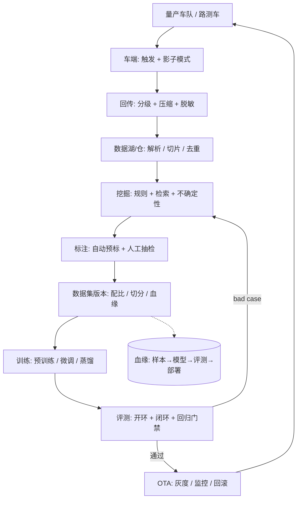

# 数据闭环全链路（ADS 视角）

> 一句话导读：**数据闭环不是"一条流水线"，而是"三段生产能力 + 两道闸门"**——采集/挖掘/标注是生产，训练是加工，评测是质检，OTA 是出货。本篇把全链路串成一张图，并说清每个环节的**输入、输出、关键模型、指标、最容易断的地方**；训练与评测的设计细节见 [[数据闭环的训练与评测]]。

---

## 🧭 本篇导读

| 项目 | 内容 |
|------|------|
| **这篇学什么** | 全链路一张图、三条岗位族、数据生产四环节、训练四件事、评测四级闸门、发布与迭代节奏、ROI 与断点诊断、指标看板 |
| **需要的前置知识** | [[数据闭环总览]]（五步框架）、[[数据挖掘与自动标注]]（挖掘/标注入门）、[[自动标注与4D标注]]、[[数据引擎与场景检索]] |
| **学完之后你能** | ① 画出自己团队的全链路并指出瓶颈；② 说清"训练"和"评测"在闭环里到底承担什么；③ 用 ROI 语言向面试官解释为什么要做某个数据项目；④ 诊断"链路哪里断了" |
| **预计阅读时间** | 60-90 分钟 |

> [!tip] 怎么读这篇
> 把本篇当**地图**，不当地图册：先看第〇节的图，再挑你工作里最痛的一段精读。**面试时最有用的不是"我知道五个环节"，而是"我知道我们那一段的瓶颈是什么、我怎么量化它"。**

---

## 〇、一张图：数据闭环全链路



> [!note] 这张图的三个读法
> ① **横向看生产**：A→F 是"把路上的世界变成可训练的数据"；② **纵向看加工**：G→I 是"把数据变成可信的模型"；③ **看回路**：I→E 是"bad case 回流"，J→A 是"新模型产生新数据"。**没有回路的闭环只是流水线。**

---

## 一、先分清：数据闭环岗其实有三个族

看 JD 就能看出来——"数据闭环"在不同公司指的不是同一件事。

| 岗位族 | 典型 title | 核心交付 | 能力要求 | 代表 JD |
|--------|------------|----------|----------|---------|
| **数据平台 / Infra** | 数据闭环高级后端、数据平台工程师 | 采集链路、湖仓、调度、标注工具、训练平台、向量库 | 大数据（Spark/Flink）、存储（HDFS/对象存储/ES）、分布式、SRE | 昆仑芯「自动驾驶数据闭环高级后端」要求挖掘框架、标注、数据管道、分布式训练、模型评测、推理部署全链路，以及 Spark/Hadoop/Storm、PB 级存储 |
| **数据算法 / 挖掘** | 数据挖掘算法、自动标注算法、数据闭环算法 | 挖掘策略、场景检索、自动标注、数据配比、质量体系 | 感知模型理解 + 检索/不确定性/主动学习 + 工程落地 | 小鹏「数据闭环 & **表征模型**算法工程师」——"表征模型"就是把场景变成 embedding 做检索/挖掘 |
| **训练 / 评测** | 训练平台、模型评测、闭环仿真 | 训练配方、蒸馏、评测体系、仿真回归 | 训练工程 + 指标设计 + 统计 | 各家的"模型评测/闭环仿真"岗 |

> [!warning] 面试第一道分水岭
> **你必须先知道自己面的是哪一族。** 平台岗会深挖 Spark 数据倾斜、PB 级存储、任务调度；算法岗会深挖检索/不确定性/自动标注；评测岗会深挖开环闭环、指标、统计显著性。**用错族的话术 = 答非所问。**

> [!note] 为什么"表征模型"会出现在数据闭环岗里
> 因为**挖掘的本质是"找相似"**——把场景编码成向量（表征），才能在亿级数据里检索"和这个 bad case 像的"。**表征模型 = 数据引擎的发动机**（[[数据引擎与场景检索]]）。这个岗名等于官方承认了"数据闭环 = 检索 + 标注 + 训练"的技术栈。

---

## 二、数据生产段：把世界变成数据

### 2.1 采集与回传：**不是采不到，是传不起**

| 环节 | 关键设计 | 失败模式 |
|------|----------|----------|
| **触发** | 接管/急刹/TTC/低置信/新旧模型分歧/场景稀有 | 触发太松 → 回传垃圾；太紧 → 漏掉真问题 |
| **车端筛选** | 轻量模型打分、关键帧切片（触发前后 10s） | 车端算力不够，只能传原始流 |
| **分级回传** | P0 实时（4G/5G）、P1 WiFi、P2 抽检 | 全传 → 月成本百万美元级 |
| **脱敏合规** | 人脸/车牌模糊、地理栅格化、境内存储 | 合规事故比技术事故更致命 |

> 📚 成本账与分级策略见 [[领域迁移与数据闭环]] 2.3；触发设计见 [[数据闭环总览]]。

### 2.2 挖掘：**从"有数据"到"有信息"**

三层漏斗：

```
规则召回（接管/急刹/场景标签） → 覆盖广、精度低
        ↓
模型打分（不确定性/检索相似度） → 排序，挑高价值
        ↓
多样性约束（去重/聚类/配额） → 防止采回 100 个同款
```

| 方法 | 找什么 | 依赖的模型 |
|------|--------|------------|
| 规则 | 明确事件（接管/碰撞） | 无（信号 + 规则） |
| 不确定性 | 模型不会的场景 | MC Dropout / Ensemble / OOD 分数 |
| 相似检索 | "和这个 bad case 像的" | 场景 embedding + ANN |
| 聚类离群 | 没见过的场景类型 | HDBSCAN / 距离度量 |
| 主动学习 | 标注预算内最值钱的 | BADGE / CoreSet |

> 📚 完整工程细节见 [[数据引擎与场景检索]]。

### 2.3 标注：**产能瓶颈，也是质量瓶颈**

```
离线 teacher（检测→跟踪→精修） → 多传感器/几何一致性校验 → 轨迹级 4D 校验
        ↓
置信度分级（A/B/C） → A 直接入库 / B 人工快审 / C 全标
        ↓
抽检 + 金标准集 + 返工率监控
```

- **框 / 4D 框轨迹**：离线 teacher + 跟踪 + 序列精修；
- **占据**：LiDAR 多帧稠密化 + 动静分离 + 体素投票（还有一堆长尾后处理）；
- **车道线/地图**：SLAM 多趟聚合 + 矢量化 + 变化检测；
- **语义/事件**：VLM 打标 + 人工核验。

> 📚 见 [[自动标注与4D标注]]。**这一段的真实工程坑**（收费站抬杆残影、锥桶闪现、上游误差级联）见该篇 8.4「工程实录」。

### 2.4 数据管理：**看不见但致命**

| 要素 | 记什么 | 为什么 |
|------|--------|--------|
| **版本** | 数据集版本号 + 内容 hash | 模型退化时能 diff |
| **血缘** | 样本 → 数据集 → 模型 → 评测 → 部署 | 定位"哪批数据害的" |
| **元数据** | 采集时间/地点/车型/标定/天气/标注方式 | 切片、配比、合规 |
| **切分** | train/val/test/hard set 固定 | 防评测集污染 |

> [!warning] 没有版本管理，后面全是玄学
> 模型退化时，第一句话应该是"**用哪版数据训的**"，而不是"再调调参"。**数据版本 + 代码版本 + 环境版本 = 可复现三件套**（[[数据挖掘与自动标注]] 第四节）。

---

## 三、训练段：把数据变成模型（设计要点）

> 📚 本节是"设计清单"，深挖见 [[数据闭环的训练与评测]] 第一~三节。

### 3.1 数据配方：训练的第一性变量

| 决策 | 怎么定 | 常见错误 |
|------|--------|----------|
| **配比（mixing ratio）** | 按场景/来源/难度分层加权，做消融 | 按"数据来源"平均，导致高速数据淹没城区 |
| **采样权重** | 类别平衡（CBGS）、难例加权 | 难例里混着错标，越加权越糟 |
| **课程（curriculum）** | 先易后难，或难例优先 | 一上来全难例 → 训练不稳 |
| **去重** | 语义去重后再配比 | 重复路段主导分布 |
| **数据量** | 画 learning curve 找饱和点 | 盲目堆量，边际收益趋零 |

> [!note] 面试高频："数据配比怎么定？"
> 标准答案不是"70/30"，而是"**分层 + 配额 + 消融**"：先按场景分层，每层设配额，再用小规模消融验证每个桶的边际收益，最后按 ROI 调。**能说出"我做过配比消融，某类数据超过 X% 后指标不再涨"，比背比例强。**

### 3.2 训练策略：四种模式

| 模式 | 什么时候用 | 关键风险 |
|------|------------|----------|
| **从零训练** | 新架构/新模态 | 成本高、周期长 |
| **微调（全参）** | 新域数据充足 | 灾难性遗忘 |
| **微调（LoRA/冻结）** | 小批新域数据 | 容量不足、欠拟合 |
| **持续学习/增量** | 周级迭代 | 遗忘 + 数据回放成本 |

**配套技术**：蒸馏（大 teacher → 小车端 student）、EMA、分层学习率、AMP、梯度累积、分布式（DDP/FSDP/ZeRO）。

> 📚 训练细节见 [[模型训练与微调]]、[[AI-Infra详解]]、[[三阶段训练范式]]；排错见 [[训练排错实战手册]]。

### 3.3 实验管理：闭环能不能"可复现"

- **配置即代码**：数据版本、超参、增强、seed 全部进 config；
- **一次实验一个 ID**：指标、日志、ckpt、数据版本绑定；
- **硬件确定性**：固定 seed + 关闭非确定性算子（至少验证集可复现）；
- **基线固定**：所有对比共享同一 baseline 配置（否则不是消融是玄学）。

### 3.4 训练与数据的接口（最容易被忽视）

```
数据集版本 v12 ──→ 训练配置 cfg_037 ──→ 模型 ckpt_037 ──→ 评测报告 r_037 ──→ 部署版本 d_037
        └──────────────────── 一条血缘链，任何一环可反查 ────────────────────┘
```

> [!warning] "训出来了但说不清怎么训的"是量产大忌
> 论文可以只报最终指标；**量产必须能回答"这个 ckpt 用了哪版数据、哪个配置、哪台机器、跑了几小时"**——否则出问题无法回滚、无法复现、无法审计。

---

## 四、评测段：把模型变成"可信的模型"（设计要点）

> 📚 深挖见 [[数据闭环的训练与评测]] 第四~七节；指标细节见 [[评测消融与GT构造]]。

### 4.1 四级评测体系

| 级别 | 评什么 | 指标示例 | 谁看 |
|------|--------|----------|------|
| **L1 单元** | 单模块 | 精度/延迟/显存 | 算法工程师 |
| **L2 任务** | 检测/跟踪/预测/规划 | mAP/NDS、MOTA、minADE、L2 | 算法 lead |
| **L3 场景** | 分场景切片 | 夜间/雨天/远距/施工区分组指标 | 数据 + 评测 |
| **L4 系统** | 闭环/路测/影子 | 碰撞率、接管率、PDMS、舒适度 | 项目/质量 |

### 4.2 回归门禁：发版的"红灯"

```
硬门槛（必须全过）:
  ① 标准集 NDS/mAP 不低于 baseline
  ② hard set（历史 bad case 哨兵）不劣化
  ③ 任一场景切片劣化 > 1 点 → 人工审
  ④ 延迟/显存不超预算
  ⑤ 安全指标（碰撞/侵入）零退化
```

### 4.3 开环 ≠ 闭环（端到端时代的核心）

| 评测 | 怎么做 | 能说明什么 | 不能说明什么 |
|------|--------|------------|--------------|
| **开环** | 喂人类轨迹，比 L2 误差 | 拟合得像不像 | 自己开会不会偏、偏了能不能救 |
| **非反应式闭环** | 模型自车跑，其他 agent 按日志 | 累积误差、偏离 | 交互（别人会不会让） |
| **反应式闭环** | 其他 agent 也响应自车 | 交互能力 | 真实感（仿真 gap） |

代表基准：nuScenes（开环）、NAVSIM（非反应式、PDMS）、Bench2Drive / CARLA Leaderboard（反应式）、nuPlan（规划闭环）。

### 4.4 统计显著性：别被 0.3 个点骗了

- 报告 **均值 ± 置信区间**（bootstrap）；
- 对比用 **配对检验**（同场景同 seed 配对，而不是两组独立均值）；
- 先定 **最小可检测效应**，再决定评测集大小；
- **警惕评测集过拟合**：反复在 val 上调参 = 把 val 变成了 train。

> [!warning] 面试官最爱的追问："涨了 0.5 个点，是真的吗？"
> 答：① 看置信区间是否跨 0；② 看是不是只在某个切片涨（可能是评测集偏差）；③ 看 seed 方差；④ 看闭环是否同向。**"涨点 + 归因 + 稳定性"三件套**才算结论。

---

## 五、发布段：让新模型安全地"上车"

```
内部评测通过 → 仿真回归 → 小范围灰度（1%）→ 扩大灰度（10%→50%）→ 全量
                     ↓ 异常
                  自动回滚 + 保留现场数据
```

| 机制 | 作用 |
|------|------|
| **灰度/Canary** | 把事故半径限制在 1% 车队 |
| **影子模式** | 新模型不控车，对比线上表现 |
| **A/B** | 同区域/同车型对照，排除混杂 |
| **自动回滚** | 指标越界立即回退 |
| **现场保留** | 出问题的那几帧必须能回传 |

> 📚 见 [[OTA更新与持续部署]]。

---

## 六、迭代节奏与 ROI：闭环的"转速"

### 6.1 三种节奏

| 节奏 | 做什么 | 谁负责 |
|------|--------|--------|
| **日** | 挖掘/预标注/数据入库 | 数据算法 + 平台 |
| **周** | 训练一版 + 回归评测 | 训练/评测 |
| **月** | OTA 大版本 + 场景覆盖评估 | 项目 + 质量 |

### 6.2 ROI 怎么算（面试必答）

$$ROI = \frac{\Delta \text{真实指标提升}}{\text{采集} + \text{存储} + \text{标注} + \text{训练} + \text{评测成本}}$$

- 分子要**可归因**：是数据带来的，还是训练/结构带来的？（消融）
- 分母要**全算**：只算标注费不算存储/算力，会高估 ROI；
- **边际收益递减**：第 1 万帧高价值数据可能涨 1 点，第 10 万帧可能只涨 0.1 点——**要找"边际收益最高的那一桶"**。

> [!note] 一句话回答"为什么要做数据闭环"
> 因为**模型的边际收益在下降，数据的边际收益还在**——但只对"对的数据"成立。数据闭环的价值 = 把"对的数据"找出来、标出来、喂进去的**速度**。

---

## 七、链路最容易断的五个地方（诊断清单）

| 断点 | 症状 | 根因 | 修法 |
|------|------|------|------|
| **① 采了没用** | 回传 PB 级，挖掘有效率 < 5% | 触发器太松/无排序 | 加不确定性打分 + 多样性约束 |
| **② 标了不准** | 自动化率很高但返工率 > 30% | 置信度阈值太松/无轨迹校验 | 几何一致性 + 4D 校验 + 抽检 |
| **③ 训了不可比** | 每次指标都变，无法归因 | 数据/配置/seed 没锁 | 版本管理 + 固定基线 |
| **④ 评了不可信** | 开环涨、闭环不涨/线下涨线上跌 | 评测分布 ≠ 真实分布 | 场景切片 + 闭环 + 影子 |
| **⑤ 发了不可控** | 上线后某场景退化 | 无灰度/无 hard set 哨兵 | 灰度 + 自动回滚 + 回归门禁 |

> [!note] 面试怎么用这张表
> 被问"你们闭环有什么问题"时，**不要说"都挺好的"**——挑一个真实断点，说清症状、根因、你怎么修的、修完指标变化。**这是"做过"和"看过"的分界线。**

---

## 八、指标看板（一张表管全链路）

| 段 | 指标 | 目标 |
|----|------|:--:|
| 采集 | 回传率、有效采集率 | 有效率 > 5% |
| 挖掘 | 挖掘有效率、检索 Recall@K | 人工认可 > 30% |
| 标注 | 自动化率、返工率、标注-人工 AP 差 | 自动化 > 90%、返工 < 10% |
| 数据 | 去重率、场景覆盖簇数、数据周转时间 | 周转 < 24h |
| 训练 | 训练吞吐、GPU 小时/版、复现成功率 | 稳定 |
| 评测 | 回归通过率、切片劣化数、闭环通过率 | 零安全退化 |
| 发布 | 灰度时长、回滚率、OTA 覆盖率 | 回滚 < 1% |
| 全局 | **迭代周期**（bad case → 上线） | 周级 |

---

## 九、常见误区速查

> [!warning] 新手最常踩的坑
> 1. **把闭环当流水线**——没有"bad case 回流"和"新数据再生"就不是闭环，只是 ETL。
> 2. **只优化单段**——闭环速度 = 最慢那一段，标注快但评测慢，整体还是慢。
> 3. **不算 ROI**——只报"我们标了 100 万帧"，不报"指标涨了多少、花了多少"。
> 4. **评测只看开环**——开环涨不等于会开车，端到端必须闭环。
> 5. **没有版本管理**——退化时查不到数据来源，只能全量重训。
> 6. **忽略合规**——脱敏/境内存储/数据出境，一条不过就是项目停摆。

---

## ✅ 检验自己（自测题）

> [!question] Q1：画一遍全链路，并指出你所在团队最强/最弱的一段。
> 提示：采集→挖掘→标注→管理→训练→评测→发布。

> [!success]- 参考答案
> 七段：采集回传、挖掘、标注、数据管理、训练、评测、发布。强弱判断看指标：挖掘有效率、返工率、数据周转、回归通过率、迭代周期。**关键不是画对图，而是能说出"我们卡在标注返工率 25%，所以我做了 4D 轨迹校验把它压到 8%"。**

> [!question] Q2：数据闭环岗分几族？你面的是哪一族？
> 提示：平台/算法/评测。

> [!success]- 参考答案
> 三族：① 数据平台/Infra（大数据、存储、调度、标注工具、训练平台）；② 数据算法/挖掘（检索、不确定性、自动标注、配比、质量）；③ 训练/评测（训练配方、蒸馏、评测体系、闭环仿真）。判断依据看 JD 动词：写"构建数据管道/湖仓/调度"是平台，写"挖掘/标注/表征"是算法，写"评测/回归/仿真"是评测。

> [!question] Q3：训练段的关键决策有哪些？数据配比怎么定？
> 提示：配方/策略/实验管理/血缘。

> [!success]- 参考答案
> 四类：数据配方（配比/采样/课程/去重/数据量）、训练策略（从零/全参微调/LoRA/持续学习 + 蒸馏/EMA/AMP）、实验管理（配置即代码、实验 ID、确定性、固定基线）、数据-模型血缘（样本→数据集→模型→评测→部署）。配比：先分层设配额，再小规模消融验证每个桶的边际收益，最后按 ROI 调，而不是拍一个 70/30。

> [!question] Q4：开环、非反应式闭环、反应式闭环各能说明什么？
> 提示：拟合 / 累积误差 / 交互。

> [!success]- 参考答案
> 开环（喂人类轨迹比 L2）：只能说明拟合得像不像，不能说明自己开会不会偏、偏了能否救。非反应式闭环（模型自车跑、其他 agent 按日志）：能暴露累积误差和偏离，但测不出交互。反应式闭环（其他 agent 也响应自车）：能测交互能力，但受仿真真实感限制。三者互补，端到端必须至少做非反应式闭环。

> [!question] Q5：ROI 怎么算？为什么"边际收益递减"很重要？
> 提示：分子分母 + 找最高的一桶。

> [!success]- 参考答案
> ROI = 真实指标提升 /（采集+存储+标注+训练+评测成本）。分母要全算，分子要可归因（消融）。边际收益递减意味着第 1 万帧高价值数据可能涨 1 点、第 10 万帧只涨 0.1 点——所以数据闭环的核心不是"多标"，而是**找到当前边际收益最高的那一桶数据**。

---

## 🛠 动手练习

### 练习 1：给你的工作画一张"断点图"（30 分钟，纸笔）

1. 按第〇节画七段链路。
2. 每段写一个指标 + 当前值。
3. 标出"最慢的一段"和"最不可信的一段"。
4. 写三句话：瓶颈是什么、根因是什么、你打算怎么修。

> [!tip] 这张图就是面试时"你做的数据闭环"的骨架
> 面试官问"你们闭环怎么样"，你直接讲这张图 + 一个断点故事。

### 练习 2：设计一版"训练-评测"闭环（45 分钟）

1. 定数据配方（三个桶 + 比例 + 为什么）。
2. 定训练策略（从零/微调/蒸馏，为什么）。
3. 定回归门禁（硬门槛 5 条）。
4. 定评测集（标准/困难/切片三类）。
5. 写一句：如果指标只涨 0.3 点，你怎么判断是不是真的。

> [!tip] 做完对照 [[数据闭环的训练与评测]]
> 重点看你的"门禁"和"统计显著性"部分是否写全。

### 练习 3：算一次数据 ROI（可选，30 分钟）

假设：某类数据采集+标注成本 20 万元，训练+评测 5 万元，指标提升 1.2 个 NDS；另一类成本 5 万元，提升 0.5 个 NDS。
1. 两类 ROI 各是多少？
2. 预算 25 万，怎么分配？
3. 如果第一类的 1.2 点里只有 0.4 点能归因到数据，结论变不变？

> [!tip] 答案方向
> ROI1 = 1.2/25 = 0.048 点/万元；ROI2 = 0.5/5 = 0.1 点/万元 → 先投第二类。归因后 ROI1 = 0.016，差距更大。**"贵的数据不一定值，便宜的数据不一定差"——这就是数据策略。**

---

## ➡️ 下一步学什么

1. **[[数据闭环的训练与评测]]** —— 本篇第三、四章的深挖：数据配方、蒸馏、回归门禁、闭环评测、统计显著性。
2. **[[数据引擎与场景检索]]** —— 挖掘段深挖：embedding、ANN、不确定性、主动学习。
3. **[[自动标注与4D标注]]** —— 标注段深挖：离线 teacher、4D、基础模型、质量体系。
4. **[[3DGS与重建式数据闭环]]** —— "造"数据：重建、编辑、仿真。
5. **[[从ADS跳槽-能力对照与查漏补缺]]** —— 把这条链路翻译成跳槽竞争力。

---

## 相关笔记

- [[数据闭环总览]] — 五步闭环的入门版
- [[数据闭环的训练与评测]] — 训练/评测深挖
- [[数据引擎与场景检索]] — 挖掘与检索
- [[自动标注与4D标注]] — 标注与 4D
- [[3DGS与重建式数据闭环]] — 重建与仿真
- [[领域迁移与数据闭环]] — Domain Gap 与回传成本
- [[评测消融与GT构造]] — 评测体系与 GT
- [[OTA更新与持续部署]] — 灰度与回滚
- [[数据闭环面试专题]] — 22 道岗位题
- [[从ADS跳槽-能力对照与查漏补缺]] — 跳槽能力对照
