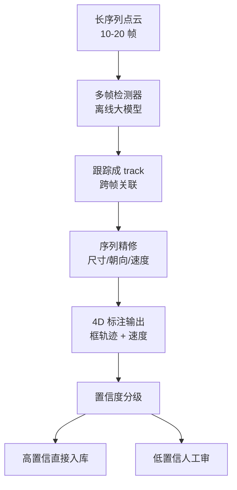

# 自动标注与 4D 标注

> 一句话导读：**数据闭环的产能瓶颈不在"采不到数据"，而在"标不动数据"**——人工标一帧 3D 框要十几分钟，自动标注把它压到秒级。本篇只讲数据闭环岗位真正会被追问的模型侧：**离线大模型标注为什么比车端模型准、4D 一致性怎么保证、SAM/开放词汇/VLM 怎么接进标注流水线、以及标注质量怎么量化**。

---

## 🧭 本篇导读

| 项目 | 内容 |
|------|------|
| **这篇学什么** | 自动标注的五种范式（离线大模型 / 多传感器交叉 / 时序 4D / 重建式 / 基础模型）、离线 teacher 为什么天然更准、4D 标注的难点、车道线与 HD Map 自动标注、标注质量与置信度分级、核心指标与面试追问 |
| **需要的前置知识** | [[数据挖掘与自动标注]]（五种技术的入门版）、[[数据闭环总览]]（闭环框架）、[[多传感器融合基础]]（投影与外参）、[[3D多目标跟踪]]（track 与卡尔曼）|
| **学完之后你能** | ① 讲清"online 模型 vs offline teacher"的差异与蒸馏关系；② 设计一条"多传感器 + 时序 + 4D"的自动标注流水线；③ 说清 SAM2/开放词汇/VLM 各自标什么、坑在哪；④ 用指标量化标注质量并回答"怎么保证标签可信" |
| **预计阅读时间** | 60-90 分钟 |

> [!tip] 怎么读这篇
> 本篇是 [[数据挖掘与自动标注]] 的**模型侧深挖**：那篇回答"自动标注有哪些招"，本篇回答"**每一招背后的模型是什么、为什么能 work、什么时候会崩**"。面试官追问"你说的自动标注具体怎么做"，答本篇的范式细节就够深。

---

## 〇、大白话：自动标注的本质是"用时间换精度"

```
车端 online 模型:  30ms 内必须出结果  → 只能看当前帧 + 少量历史
云端 offline 模型: 30 分钟出结果也行  → 可以看前后 20 帧、累积点云、跑大模型、集成多个模型
                  ↓
        同一个任务，offline 的精度上限远高于 online
```

> [!note] 一个比喻：现场刑警 vs 事后专案组
> **车端在线模型 = 现场刑警**：必须在几秒内判断"前面那个东西危不危险"，信息只有眼前这一点。
> **云端离线标注模型 = 事后专案组**：可以把前后几天的监控（多帧、多传感器）全部调出来反复看，还能请专家会诊（模型集成）。
> **同一个案子，专案组的结论一定更准**——这就是"离线 teacher 标伪标签、在线 student 学"的根本逻辑，也是**知识蒸馏在数据侧**的形态（[[模型训练与微调]] 的蒸馏）。

**所以自动标注的第一性原理**：**把"实时性约束"从标注任务里去掉**，用算力换精度，再用蒸馏把精度搬回车上。

---

## 一、先分清：自动标注到底在标什么

面试时很多人一开口就是"用大模型标 3D 框"，但真实流水线里**标注对象有六类，难度和范式完全不同**：

| 标注对象 | 输出形态 | 难点 | 主要范式 |
|----------|----------|------|----------|
| **3D 框** | (x,y,z,l,w,h,yaw,class,velocity) | 遮挡、远距稀疏、朝向歧义 | 离线检测 + 跟踪 + 精修 |
| **3D 语义/实例分割** | 点级/体素级类别 | 边界模糊、类别长尾 | 重建式 + 基础模型 |
| **占据栅格** | 体素 occupancy + 语义 | 未观测区域（unknown） | LiDAR 稠密化（半自动，见 [[评测消融与GT构造]]）|
| **车道线 / HD Map** | polyline + 拓扑 | 多趟聚合、变化检测 | SLAM 建图 + 矢量化 |
| **轨迹 / 行为** | 未来轨迹、加减速 | 多模态、交互 | 跟踪轨迹 + 人工修 |
| **场景标签** | 天气/道路/事件/描述 | 语义开放、主观 | VLM / 分类器 |

> [!warning] 面试陷阱：只谈 3D 框
> 端到端和占据时代，**"框"只是标注的一小部分**——端到端要轨迹和驾驶指令，占据要体素，无图方案要车道线拓扑。**能说出"我们按标注对象分六条子流水线"**，立刻和"只会背自动标注名词"的候选人区分开。

---

## 二、范式一：离线大模型标注（Offboard Teacher）——最主流、最赚钱

### 2.1 为什么离线一定更准：四个"时间红利"

| 红利 | 在线模型 | 离线 teacher | 收益 |
|------|----------|--------------|------|
| **未来帧** | 看不到 | 双向看前后 10-20 帧 | 遮挡目标可被"后面帧"补出来 |
| **点云密度** | 单帧 ~10 万点 | 20 帧累积 ~百万点 | 远距/小目标从"几个点"变"一小片" |
| **模型规模** | 车端算力 100 TOPS 以内 | 云端 A100 集群无上限 | 可用大 backbone + 高分辨率 + 多模型集成 |
| **后处理预算** | 毫秒级 | 分钟级 | 可做 TTA、多模型投票、全局优化 |

### 2.2 标准三步：检测 → 跟踪 → 精修



**① 多帧检测**：把连续 N 帧点云按自车位姿拼到同一坐标系，用大模型一次性检测。**关键**：不是"每帧独立检测再融合"，而是**把序列当输入**——这让网络能利用运动信息区分"移动的车"和"静止的背景"。

**② 跟踪成 track**：用 3D MOT（[[3D多目标跟踪]]）把逐帧框关联成轨迹。这一步决定了 4D 标注的"ID 一致性"——**ID 跳变是自动标注最贵的错误**（下游跟踪/预测模型会学到错误的身份连续性）。

**③ 序列精修**：以整条 track 为单位，联合优化尺寸、中心、朝向、速度。单帧检测的抖动被时序平滑掉，**速度 GT 从"帧间差分"升级为"轨迹拟合"**，精度提升一个量级。

> [!note] 代表工作（面试可点名）
> - **Waymo Offboard 3D Detection**（2021，常被称作 3DAL）：把"离线 3D 检测"当成独立问题，coarse-to-fine 四步——① 离线检测器 + 卡尔曼跟踪得到每目标轨迹；② 按轨迹把目标点云抠出（序列目标点云 + 序列框）；③ 动静分类（多帧叠加后动态目标成"拖影"、静态目标更完整）；④ 分别精修。它用长序列点云做多帧检测 + 跟踪 + 精修，论文报告其在 Waymo 上的离线标注精度已**超过人工标注水平**——这是"自动标注可以比人准"的标志性结论。
> - **DetZero**（ICCV 2023）：在 Waymo 长序列上把"多帧检测 + 跟踪 + 精修"做成完整离线管线，同样报告离线标注精度超过人工标注——和 Waymo 那条线互相印证"离线能比人准"。
> - **Auto4D**（Uber，CVPR 2023）：直接面向"4D 标注"（框 + 轨迹），把目标属性拆成"不变属性（尺寸/类别）"和"运动属性（位置/朝向）"两个分支分别回归，解决"单帧检测拼起来不构成合法轨迹"的问题。
> - **3D 自监督标注 / 3DAL 系**（CVPR 2023）：3D 检测器 + 2D 分割（SAM 类）+ 多目标跟踪 + 稠密框拟合，走"2D 掩码 → 3D 框"路线，重点是**少人工**。

> [!example] Waymo 离线精修的两个分支（看懂这段，面试能讲 5 分钟）
> **静态目标**：把多帧点云从世界系转到目标中心系 → PointNet 分离前景/背景点 → 回归中心、朝向、尺寸、类别。
> **动态目标**：前景分割网络输入 5 帧（当前帧 + 前后各 2 帧，每帧降采样 1024 点）+ 时间编码 → 点云 embedding；框序列编码器输入整条轨迹（约 101 帧）→ **trajectory embedding**；两者拼接成 joint embedding → 回归尺寸。
> **为什么这么设计**：动态目标的几何被运动"抹开"了，单看一帧尺寸估不准，必须把"整条轨迹"作为上下文。

> 📚 参考：[数据闭环的核心 - Auto-labeling 方案分享](https://blog.csdn.net/cv_autobot/article/details/147134825)（Waymo/Uber/MPPNet/HDMapNet 工程拆解，细节以原文为准）。

### 2.3 离线 teacher 与在线 student 的关系（必考）

```
离线 teacher（准、慢、贵）
      │  生成伪标签
      ▼
大规模伪标签数据集
      │  训练 / 蒸馏
      ▼
在线 student（快、便宜、可上车）
```

> [!warning] 别把"蒸馏"理解窄了
> 这里的蒸馏是**数据侧蒸馏**：teacher 不直接教 student 的 logits，而是**教它"什么是正确答案"**（伪标签）。真正的 logits 蒸馏（[[模型训练与微调]]）是第二步。**两步合起来才是"以 AI 养 AI"的完整链路**：teacher 标数据 → student 学数据 → student 上车 → 车端数据回流 → teacher 再标。

---

## 三、范式二：多传感器交叉验证——用"物理一致性"免费换置信度

### 3.1 核心思想：三个证人

| 传感器 | 提供什么 | 不可替代性 |
|--------|----------|------------|
| **Camera** | 语义（是什么）、纹理 | 类别判断最准 |
| **LiDAR** | 几何（在哪、多大） | 距离/尺寸最准 |
| **Radar** | 径向速度（多普勒） | 测速最准、全天候 |

**规则**：三者同时命中 → 高置信度，免人工；只有一路命中 → 低置信度，进人工队列。

### 3.2 更硬的做法：重投影一致性

比"三路都检测到"更严格的是**几何自洽**：

```python
# 伪代码：用 LiDAR 点云验证 2D 检测框 / 3D 框
for box_3d in lidar_boxes:
    pts_in_box = points_inside(box_3d)          # 框内点数
    pts_ratio = len(pts_in_box) / expected_pts(box_3d.distance)  # 按距离归一化的点数占比
    proj = project_to_image(box_3d, K, T_cam_lidar)  # 投影到每个相机
    iou_2d = iou(proj, cam_box_2d)              # 与 2D 检测的 IoU
    if pts_ratio > 0.6 and iou_2d > 0.7:
        confidence = "high"    # 几何 + 语义双证
```

> [!note] 为什么"一致性"比"置信度"可靠
> 模型输出的 softmax 置信度**会过度自信**（calibration 问题，见 [[模型基础知识补充]]）。而**几何一致性是物理约束**：框里没点、投影对不上，就是错的——不依赖模型自我评价。**"用物理规律当裁判"是自动标注质量的第一道防线。**

---

## 四、范式三：时序与 4D 一致性——自动标注的"合法性检查"

### 4.1 为什么必须有 4D

单帧标得再准，拼成轨迹也可能是**物理上不合法**的：

```
Frame t:   车在 x=10m
Frame t+1: 车在 x=25m   （15m / 0.5s = 30m/s = 108km/h，城市道路不可能）
→ 单帧都对，轨迹是错的 → 下游预测/规划模型学歪
```

**4D 标注 = 3D + 时间**，输出的是**带速度/加速度的框轨迹**，而不只是一堆独立的框。

### 4.2 三类 4D 一致性约束

| 约束 | 检查什么 | 违反的典型原因 |
|------|----------|----------------|
| **运动学** | 速度/加速度在物理范围内、朝向与速度方向一致 | 跟踪 ID 跳变、框抖动 |
| **外观** | 同一 track 的点云/图像特征相似 | ID 交换（两辆相似车） |
| **遮挡逻辑** | 目标不会"凭空消失又出现"（除非真的被遮挡） | 漏检、遮挡处理错误 |

```python
import numpy as np

# 伪代码：轨迹级合法性过滤（track: centers [T,3], yaw [T], dt 秒）
def check_track(track, dt, a_max=8.0):          # a_max 单位 m/s^2
    v = np.diff(track.centers, axis=0) / dt      # 逐帧速度 [T-1,3]
    a = np.diff(v, axis=0) / dt                  # 加速度 [T-2,3]
    if np.abs(a).max() > a_max:
        return "reject"                          # 加速度超限
    heading = np.arctan2(v[:, 1], v[:, 0])       # 速度方向
    diff = np.abs(np.arctan2(np.sin(track.yaw[1:] - heading),
                             np.cos(track.yaw[1:] - heading)))  # 角度差，处理环绕
    if diff.max() > np.deg2rad(30):
        return "reject"                          # 朝向与运动方向矛盾
    if track.gap_frames > 5 and not track.occluded:
        return "review"                          # 无故消失
    return "pass"
```

> [!warning] 4D 标注最贵的两个错误
> ① **ID switch**：两辆车交换身份 → 轨迹速度突变 → 预测模型学到"车会瞬移"。
> ② **框抖动（jitter）**：中心/尺寸逐帧跳 → 速度 GT 噪声大 → 跟踪/预测精度上限被压低。
> 这两个错误**人工抽检很难发现**（单帧看都正常），必须靠轨迹级指标（见第八、九节）。

### 4.3 4D 的进阶形态：占据 + 场景流

2025 年后，"4D 标注"逐渐从"框轨迹"扩展到**稠密 4D**：
- **4D 占据**：每帧每个体素的 occupancy + 语义 + 未来预测（Occ3D / SurroundOcc 的时序版）。
- **场景流（scene flow）**：每个点的 3D 运动矢量，给预测/规划提供稠密运动监督。
- **4D 全景分割**：实例 mask 在时间上的连续体（track + mask），是"框"的上位替代。

> [!note] 为什么端到端时代 4D 更重要
> 端到端模型直接吃"场景 → 轨迹"，**中间没有框这个接口**——它需要的是**稠密的、时序一致的场景监督**（占据/流/mask），而不是稀疏的框。**"框标注 → 4D 稠密标注"的迁移，是数据闭环团队 2025-2026 最实际的技术升级方向。**

---

## 五、范式四：重建式标注（NeRF/3DGS）——标一次，投影回所有帧

一句话原理：**多帧多视角 → 重建 3D 场景 → 在 3D 空间标一次 → 渲染/投影回每一帧**。标注量从 O(帧数) 降到 O(场景数)。

> 📚 完整原理（NeRF vs 3DGS、动态场景、编辑与仿真）见 [[3DGS与重建式数据闭环]]——本篇只放它在标注流水线里的位置。

**适用**：静态场景元素（车道线、路沿、标牌、建筑）、可分离的动态物体、需要新视角 GT 的场景。
**不适用**：需要绝对几何精度的远距目标、强反射/透明物体、剧烈光照变化。

---

## 六、范式五：基础模型标注（SAM2 / 开放词汇 / VLM）

### 6.1 SAM2：把"分割"变成"可提示 + 可传播"

| 能力 | 标注里怎么用 |
|------|--------------|
| **点/框提示分割** | 人工点一下目标 → 得到精确 mask（替代多边形描边） |
| **视频记忆传播** | 标一帧 → 自动传播到整段视频（时序一致性免费） |
| **类别无关** | 没见过的东西也能分割（长尾物体） |

**典型流水线**：`SAM2 出 2D mask → 与 LiDAR 点云/深度反投影 → 3D 实例 → 拟合 3D 框/占据`。

> [!warning] SAM2 的坑：mask 好 ≠ 3D 好
> SAM2 给的是**2D 像素级 mask**，反投影到 3D 时：遮挡边界会"糊"、远距像素对应深度误差大、动态物体跨帧对齐依赖位姿精度。**SAM2 解决"描边"，不解决"3D 几何"**——3D 部分仍要靠 LiDAR/多视角几何。

### 6.2 开放词汇检测：给"长尾类别"开口子

- **Grounding DINO / GLIP**：文本提示 → 检测框（"施工围挡""掉落纸箱""动物"）。
- **价值**：训练集没有的类别，**用文字描述就能标**——这正好补 [[占据网络与GOD]] 里"GOD 知道有障碍、但不知道是什么"的语义缺口。
- **风险**：开放词汇模型的框**召回高但精度低**，必须配人工抽检或几何验证。

### 6.3 VLM：标"语义"而不是标"框"

VLM 擅长的是**场景级描述**：天气、道路类型、交通事件、风险描述、驾驶指令——这些**人标起来最贵、最主观**的标签。

| 用途 | 输出 | 注意 |
|------|------|------|
| 场景自动打标 | "雨夜/城市主干道/有施工/非机动车多" | 用于检索与数据配比 |
| 事件描述 | "前车掉落纸箱，本车向左避让" | 端到端/VLA 的语言监督 |
| 指令生成 | "前方路口右转" | 端到端驾驶指令标签 |

> [!warning] VLM 标注的三条红线
> ① **幻觉**：会"看到"不存在的东西（[[大模型与自动驾驶]]）→ 必须与感知结果交叉验证；
> ② **不可定位**：给不出精确 3D 坐标 → 只能标语义，不能标几何；
> ③ **一致性差**：同一场景两次调用结果不同 → 需要固定 prompt + 温度 0 + 多次投票。

---

## 七、车道线与 HD Map 自动标注（无图时代的刚需）

```
多趟采集（同一路段跑 N 次）
        ↓
SLAM / 位姿图优化 → 点云与图像聚合到统一世界坐标
        ↓
BEV 语义分割（车道线/路沿/停止线/箭头）
        ↓
矢量化（polyline 拟合 + 拓扑构建 + 属性）
        ↓
变化检测（只对"与旧图不同"的区域人工复核）
```

**三个关键点**：
1. **多趟聚合**：单趟遮挡多，多趟取"最清晰的一次"，还能做一致性投票。
2. **矢量化**：像素/点云 → polyline 是**拟合问题**（MapTR 式的一阶段 Transformer 也能直接出 vector，见 [[有图导航与无图导航]] 的无图方案）。
3. **变化检测**：全量重标不可能，只标"变了的地方"——这是地图标注能规模化的前提。

> [!note] 在线建图模型在这里的角色
> MapTR 这类**在线建图模型**本身可以作为**离线标注器**：多趟推理 → 融合 → 矢量化 → 人工只修拓扑错误。**"在线模型离线化当标注器"是所有标注流水线的通用套路**（同第二节的 teacher 逻辑）。

---

## 八、标注质量体系与工程实录：怎么证明"自动标出来的能用"

### 8.1 置信度分级（人机协同的核心）

| 置信度 | 判据 | 处置 | 占比目标 |
|:--:|------|------|:--:|
| **A（高）** | 多传感器命中 + 轨迹合法 + 几何自洽 | 直接入库 | 60-80% |
| **B（中）** | 单一来源或轨迹有缺口 | 人工快速审（只改错） | 15-30% |
| **C（低）** | 冲突/长尾/新类别 | 人工全标 | <10% |

### 8.2 质量的四个量化维度

| 维度 | 指标 | 怎么算 |
|------|------|--------|
| **准确率** | 与人工标注的 AP 差 / 框 IoU 匹配率 | 抽样 500 帧人工精标做金标准 |
| **一致性** | 轨迹 ID 保持率、跨帧框抖动（Jitter） | track 级统计 |
| **完整性** | 漏标率（Recall） | 金标准集上统计 |
| **经济性** | 自动化率、返工率、每帧成本 | 流水线埋点 |

> [!warning] 最容易被忽略的指标：返工率
> **"自动标注率 90%"听起来很美，但如果 40% 的标签被人工打回重标，实际成本比"自动 60%"还高。** 面试时主动提"我们盯返工率而不是只看自动化率"，是**真正做过流水线**的信号。

### 8.3 标注 → 训练的反馈闭环

```
训练后评测发现某类持续变差
        ↓
反查该类标签质量（是模型问题还是 GT 问题？）
        ↓
标签质量问题 → 修标注规则/换 teacher/加人工
模型问题     → 加数据/改结构
```

> [!note] 这是数据闭环岗位的"核心竞争力"
> 大多数团队只做"标完就训"，**能把"模型 bad case"归因到"标签质量"的人极少**。[[评测消融与GT构造]] 讲的"GT 质量 5% 错误"就是这件事的量化版。

### 8.4 工程实录：OCC 真值自动标注的五个坑（面试最加分）

占据（Occupancy）真值不是"标"出来的，是**算**出来的。一条典型的 LiDAR 方案流水线：

```
预标注（动态框 + 自车位姿 + 点云语义分割）
        ↓
动静分离（按框拆动态点 / 静态点）→ 几何与密度去噪
        ↓
多帧聚合（动态：按框坐标系；静态：按世界系 + 运动补偿）
        ↓
稠密化（点级叠帧 + 体素级形态学膨胀 / 腐蚀）
        ↓
体素化 + 投票定语义 → 输出语义 OCC
```

跑通不难，**难的是长尾后处理**——下面五个坑几乎每家都踩过：

| 坑 | 现象 | 根因 | 处理思路 |
|----|------|------|----------|
| **静态可动元素残影** | 收费站抬杆/道闸在叠帧后出现"拖影" | 它物理上静止但时序上可动，简单前向叠帧会残留历史状态 | 单独分离聚类 → 时序跟踪取几何属性 → 只放当前时刻状态，并过滤扫射范围无效点 |
| **可移动障碍物（Void）** | 被挪动的垃圾桶/路障留下残影 | 同上，位置变了但被当成静态 | 用相邻多帧点云命中次数投票，低于阈值直接置空该体素 |
| **小目标（锥桶）闪现** | 盲区导致漏框/ID 跳变，点云放不进去 | 目标太小 + 自车盲区 + 跟踪断裂 | 固定实例全局位姿，按生命周期与窗口"脑补"补帧，强制更新当前帧占据 |
| **上游误差级联** | 分割错/框不全 → 点云残留 → 空间里出现"空中杂点"、动态目标形状畸变 | 真值生成极度依赖上游预标注质量 | 动静分离 + 去噪 + 上游质量门禁 + 人工抽检（**这是最根本的坑**）|
| **算力/存储黑洞** | 全域叠帧 + 稠密体素化，内存和时间爆炸 | 体素数 = 范围/分辨率³ | 分块（tile）、ROI 裁剪、稀疏存储（parquet + Uint8）、缓存复用 |

> [!note] 两个"规格"细节（面试可讲）
> ① **行车 vs 泊车的体素规格不同**：行车看远（如 X 到 115m、0.2×0.2×0.25m），泊车看近场精度（如 0.05×0.05×0.08m）——**同一套 pipeline 要按场景出两套规格**。
> ② **语义状态要含"非占据"**：如 21 类语义 + Free/Invalid 两类状态，否则模型学不会"哪里是空的"。

> [!warning] 为什么不用纯视觉大模型方案（AutoOcc 类）
> 视觉方案（VLM 开放词汇 + SAM + 深度估计 + 3DGS 渲染）语义一致性惊艳、能标开放类别，但**效果强依赖深度估计和 VLM 的上限**，动态物体/快速变形场景鲁棒性不足。**量产要的是"可控、稳定、可复现"**——所以多数团队仍以 LiDAR 几何为主、视觉语义为辅，等基础模型稳定后再切换。**这个"前沿 vs 落地"的取舍，是面试官最爱听的一段。**

> 📚 参考：[3D Occupancy 真值自动标注系统架构与踩坑实录](https://blog.csdn.net/JiShuiSanQianLi/article/details/160189280)（公开工程分享，细节以其原文为准）。

---

## 九、核心指标速查

| 指标 | 定义 | 经验目标 |
|------|------|:--:|
| **自动化率** | 免人工标签 / 总标签 | > 90% |
| **返工率** | 被人工打回修改的比例 | < 10% |
| **标注吞吐** | 每 GPU·小时产出的帧数 | 持续优化 |
| **标注-人工 AP 差** | 自动标签训练的模型 vs 人工标签训练的模型 | < 1-2 点 |
| **轨迹 ID 保持率** | 同一目标 track 不断裂的比例 | > 95% |
| **数据周转时间** | 采集 → 标签可用 | < 24h |

---

## 十、常见误区速查

> [!warning] 新手最常踩的坑
> 1. **以为"自动标注 = 用现成模型跑一遍"**——真实流水线是"检测 → 跟踪 → 精修 → 一致性校验 → 置信度分级"五段式，**精修和校验才是精度来源**。
> 2. **只标单帧不看轨迹**——单帧都对、轨迹物理上不合法（速度突变/ID 跳变），下游预测模型会学歪；4D 一致性是合法性检查。
> 3. **迷信模型置信度**——softmax 会过度自信；**几何一致性（重投影/框内点数）比置信度可靠**。
> 4. **以为 SAM2 能解决 3D 标注**——SAM2 解决 2D 描边，3D 几何仍靠 LiDAR/多视角；反投影会放大深度误差。
> 5. **只看自动化率不看返工率**——自动率高但返工率高 = 成本更高；要盯"净收益"。
> 6. **忘了标注对象不止框**——端到端要轨迹/指令，占据要体素，无图要车道线拓扑；**按对象分流水线**。

---

## ✅ 检验自己（自测题）

> [!question] Q1：为什么离线 teacher 的标注精度能超过车端 online 模型？说出至少三个"时间红利"。
> 提示：未来帧、点云密度、模型规模、后处理。

> [!success]- 参考答案
> ① 未来帧：离线可双向看前后 10-20 帧，被遮挡目标能由后续帧补出，online 看不到未来；② 点云密度：20 帧累积把单帧 10 万点变成百万点，远距小目标从几个点变一小片；③ 模型规模：云端无算力上限，可用大 backbone、高分辨率、多模型集成；④ 后处理预算：毫秒级变分钟级，可做 TTA、投票、全局优化。所以离线是"用时间换精度"，再蒸馏回在线。

> [!question] Q2：自动标注流水线的标准三步是什么？为什么"序列精修"不能省？
> 提示：检测→跟踪→精修。

> [!success]- 参考答案
> 三步：多帧检测（长序列点云当输入，利用运动信息）→ 跟踪成 track（3D MOT 关联，保证 ID 一致）→ 序列精修（以整条 track 为单位联合优化中心/尺寸/朝向/速度）。不能省的原因：单帧检测有抖动和遮挡漏检，拼起来轨迹不合法（速度突变、ID 跳变、框 jitter）；精修用时序平滑把速度 GT 从"帧间差分"升级为"轨迹拟合"，精度提升一个量级。

> [!question] Q3：4D 标注最贵的两个错误是什么？为什么人工抽检发现不了？
> 提示：ID switch、jitter。

> [!success]- 参考答案
> ① ID switch：两辆车交换身份，轨迹速度突变，预测模型学到"车会瞬移"；② 框抖动：中心/尺寸逐帧跳，速度 GT 噪声大。人工抽检看单帧都正常（每帧框都在正确位置），只有做轨迹级统计（速度/加速度曲线、朝向与运动方向一致性、ID 保持率）才能发现——所以必须做轨迹级自动校验。

> [!question] Q4：SAM2、开放词汇检测、VLM 在标注里各负责什么？各自的坑是什么？
> 提示：2D mask / 长尾类别 / 语义。

> [!success]- 参考答案
> SAM2：点/框提示出精确 2D mask + 视频传播，替代人工描边，类别无关；坑是只解决 2D，反投影到 3D 会放大深度误差、遮挡边界糊。开放词汇（Grounding DINO）：文本提示标训练集没有的长尾类别；坑是召回高精度低，需人工/几何校验。VLM：标场景级语义（天气/事件/指令），人标最贵最主观的部分；坑是幻觉、不可定位、一致性差（需固定 prompt + 温度 0 + 投票）。

> [!question] Q5：为什么"返工率"比"自动化率"更能反映标注流水线的真实水平？
> 提示：净成本。

> [!success]- 参考答案
> 自动化率只说明"多少标签没经过人工"，但如果其中大量标签被人工打回重标，实际人工成本反而更高（重标比重标更贵，因为要先看懂再改）。返工率衡量"自动标签的可信度"，两者合起来才是净成本。真实目标是"高自动化率 + 低返工率"，而返工率只能靠置信度分级 + 一致性校验来压。

---

## 🛠 动手练习

### 练习 1：设计一条 3D 框自动标注流水线（40 分钟，纸笔）

给一个"8 相机 + 1 LiDAR + 5 Radar"的量产车数据，设计流水线：
1. 列出五个阶段（检测/跟踪/精修/校验/分级），每阶段写输入输出。
2. 为每个阶段指定一种模型或算法（可用 [[BEV感知全景]]、[[3D多目标跟踪]] 里的方法）。
3. 标出哪些阶段是"精度来源"，哪些是"成本来源"。

> [!tip] 做完自问
> ① 你的"精修"用了什么信息？（如果只用了单帧，等于没精修）② 置信度分级的三档判据能量化吗？③ 如果 LiDAR 缺失，流水线怎么退化？（呼应 [[多传感器融合与故障降级]]）

### 练习 2：写一个轨迹合法性检查器（60 分钟，代码）

用 numpy 实现第四节 `check_track` 的完整版：
1. 输入：一条 track 的 `centers [T,3]`、`yaw [T]`、`visible [T]`、`dt`。
2. 检查：加速度上限、朝向-速度一致性、无故消失、尺寸突变。
3. 输出：`pass / review / reject` + 原因码。
4. 造 3 条假轨迹（正常/ID 跳变/遮挡消失）测试。

> [!tip] 这就是面试里"你怎么保证 4D 标签质量"的实证
> 能说"我写过轨迹合法性检查，ID 跳变和朝向矛盾都能自动抓"，比背概念强十倍。

### 练习 3（进阶）：估算自动标注的经济账

假设：人工标 1 帧 3D 框 12 分钟、时薪 40 元；自动标注流水线每帧 GPU 成本 0.02 元；自动化率 85%、返工率 8%（返工按人工 1/3 时间算）。
1. 算每帧的"纯人工 vs 流水线"成本。
2. 算盈亏平衡的自动化率（返工率固定 8%）。
3. 写一句结论：什么情况下"提高自动化率"反而更亏？

> [!tip] 答案方向
> 自动化率提升如果伴随返工率上升（比如放宽置信度阈值放行更多低质标签），净成本可能上升——**这就是为什么"分级阈值"要按"净成本"调，而不是按"自动化率"调**。

---

## ➡️ 下一步学什么

1. **[[数据引擎与场景检索]]** —— 标什么由挖掘决定：怎么用 embedding 检索把"一个 corner case"变成"一千个相似场景"。
2. **[[3DGS与重建式数据闭环]]** —— 本篇第五节的重建式标注展开：NeRF/3DGS 原理、动态场景、编辑与仿真。
3. **[[评测消融与GT构造]]** —— 标签质量的上游：GT 怎么造、怎么量化、怎么防"GT 错误压缩精度上限"。
4. **[[数据挖掘与自动标注]]** —— 回到入门版，检查五种技术的全局位置。

> 💡 本篇是"数据生产链"的模型侧核心：**挖掘决定标什么（[[数据引擎与场景检索]]），标注决定标多快（本篇），质量决定能不能用（[[评测消融与GT构造]]）**——三篇合起来是数据闭环岗位的技术底盘。

---

## 相关笔记

- [[数据挖掘与自动标注]] — 五种自动标注技术的入门版（本篇是其模型侧深挖）
- [[数据闭环总览]] — 五步闭环框架（本篇是第 3 步深入）
- [[3DGS与重建式数据闭环]] — 重建式标注的原理展开
- [[数据引擎与场景检索]] — 上游：标什么由挖掘决定
- [[3D多目标跟踪]] — 跟踪成 track 的算法基础
- [[多传感器融合基础]] — 交叉验证与投影的物理基础
- [[评测消融与GT构造]] — 标注质量与 GT 构造
- [[占据网络与GOD]] — 占据标注与"知道有障碍但不知是什么"
- [[有图导航与无图导航]] — 车道线/HD Map 自动标注的业务背景
- [[智驾算法面试题库]] — 数据闭环面试题
