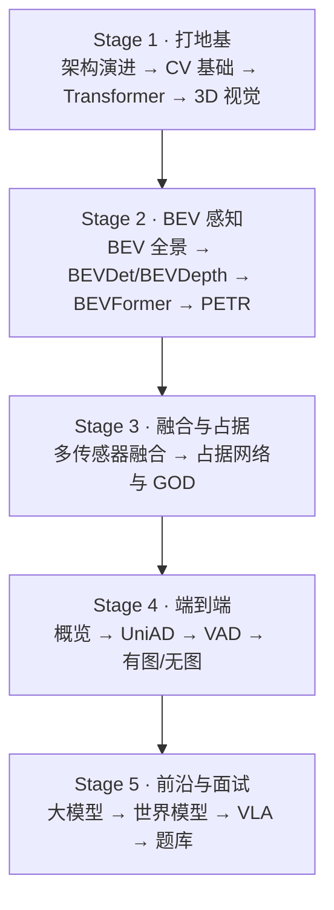

# 🚗 智驾模型知识库 · AutoDrive Learning Note

    

> **从零基础到面试通关的自动驾驶模型学习笔记库** —— 不是收藏夹，是一套能**一步步学完**的教学版知识库：先白话后公式、每篇带自测和练习、按站式路径无痛推进。

| | |
|---|---|
| 🧭 **42 站学习路径** | 从 MLP/CNN 打地基 → BEV 感知 → 端到端 → VLA，每站有预计时间 + 产出 + 自测，按顺序学完即入门（见 [[00-学习路径]]）|
| 📖 **40+ 篇教学化笔记** | 每篇都是「导读 → 白话比喻 → 公式 → 误区速查 → ✅自测 → 🛠练习 → ➡️下一步」，为初学者设计，不是缩写速查表 |
| 🧪 **8 篇前沿论文精读** | DriveVLA-W0、Alpamayo-R1、Waymo 世界模型、ChainFlow-VLA… 每篇含架构图 + 面试追问 + 参考答案（[[论文索引]]）|
| 🎯 **100+ 道面试题** | 经典感知题 + 2026 VLA 前沿题 + **数据闭环岗 22 题** + **前沿速答 32 题**（MapTR/CLIP-VLM/扩散），每题带「先结论→展开→举例」（[[智驾算法面试题库]]、[[数据闭环面试专题]]、[[面试速答卡-在线建图-多模态-扩散]]）|
| 🎤 **面试临场件** | [[简历-数据闭环]]（两版简历 + 口径表）+ [[投递定位-数据算法岗与算法岗]]（一稿两投）+ [[项目打磨-从工作到offer]]（项目卡/三版陈述）+ [[2026下半年热点速答]]（十条热点 + 连接话术）+ [[项目深挖追问链]]（6 条链）+ [[面试前72小时清单]]（T-72h→T-3h）+ [[Python手撕速答卡]]（默写版）+ [[从ADS跳槽-能力对照与查漏补缺]]（厂商矩阵/12 项能力/90 天计划）|
| 🔄 **数据闭环主线** | 以数据闭环为主体的一条完整线：[[数据闭环全链路]] → [[数据引擎与场景检索]] → [[自动标注与4D标注]] → [[数据闭环的训练与评测]] → [[3DGS与重建式数据闭环]] → [[数据闭环面试专题]]；跳槽对照见 [[从ADS跳槽-能力对照与查漏补缺]] |
| 🔄 **月度更新机制** | 每月扫描热点 → 精读 1-2 篇论文 → 补面试题 → 更新华为/特斯拉量产动态，有方法论笔记保证可持续（[[前沿追踪与面试准备]]）|
| 🎨 **可视化讲解** | 10+ 张 mermaid 架构图（模型演进、BEV 流程、端到端链路…），先看图再读字 |

**为什么值得看？** 市面上的自动驾驶资料要么是"名词速查表"——看完还是不会；要么是"论文堆砌"——新手直接劝退。这个库走中间路线：**每个概念先用大白话和比喻讲透，再上公式**；每篇笔记末尾都有自测题和动手练习，确认你懂了才放你去下一站。42 站走完，你能从零讲清"BEV 怎么来、端到端怎么进化、VLA 为什么是下一个风口"——而这些，恰好也是面试官爱问的。

> 🚀 **开始学习** → 打开 [[00-学习路径]] 从第 1 站走起；想快速浏览全库 → [[000-知识库地图]]；查进度 → [[学习计划]]。

---

## 📂 目录结构（已按学习顺序重排，2026-08）

| 文件夹 | 内容 |
|--------|------|
| `00-方法论/` | 📝 笔记写作规范、后续扩展大纲、前沿追踪（本库的"写作宪法"） |
| `01-基础理论/` | 模型架构演进、CV 基础、Transformer、3D 视觉、模型基础知识 |
| `02-感知模型/` | BEV 感知、多传感器融合、占据网络、GOD |
| `03-端到端模型/` | End-to-End 自动驾驶、规划控制、world model、有图/无图 |
| `04-训练与工程/` | 数据闭环（总纲/全链路/挖掘/标注/训练评测/重建）、模型训练/微调、自动标注、OTA 部署 |
| `05-论文阅读/` | 论文笔记 + 论文解读（按方向整理） |
| `06-代码实践/` | 代码复现、实验记录、**[[小车项目总览\|自动驾驶小车]]** 🚗 |
| `07-每日记录/` | 每日学习日记（`Ctrl+D`） |
| `08-资源索引/` | 数据集、开源项目、课程、博客链接 |
| `09-面试准备/` | 面试题、复习策略 |
| `10-前沿追踪/` | VLA、具身智能、华为动态（月度更新） |

> 🧭 **学习顺序**：01 → 02 → 03 → 04 → 05 → 06，每篇笔记末尾有"下一步学什么"。完整站点式主线见 [[00-学习路径]]。

---

## 🗺️ 知识库整体架构（一张图看懂学什么）

> 🧩 **每篇笔记都有**：导读 → 白话讲解 → 公式 → 误区速查 → 自测题 → 练习 → 下一步指引。

---

## 🧠 核心学习路径（2026-08 重排：循序渐进）

> 📌 **调整说明**：新增 [[模型架构演进]] 衔接 MLP/CNN 基础；[[多传感器融合基础]] 移到 BEV 之后（融合依赖模型基础）。

### Stage 1：模型基础（打地基）

- [ ] 模型架构演进（MLP→CNN→Transformer→ViT→DETR，配图衔接基础）
- [ ] 计算机视觉基础（CNN, 目标检测, 语义分割）
- [ ] Transformer 架构（Attention, ViT, DETR）
- [ ] 3D 视觉（点云, 体素, 投影变换, 相机模型）

### Stage 2：BEV 感知（Transformer 的应用）

- [ ] BEV 核心思想：为什么需要鸟瞰图？
- [ ] BEVDet / BEVDepth — 纯视觉 BEV 方案
- [ ] BEVFormer — 时序 BEV 特征变换
- [ ] PETR 系列 — 位置嵌入变换

### Stage 3：多传感器融合 + 3D 占据（有模型基础后）

- [ ] 多传感器融合（LiDAR + Camera + Radar）⭐ 移到 BEV 之后
- [ ] 占据网络（OccNet / TPVFormer / GOD）

### Stage 4：端到端

- [ ] UniAD — 统一的端到端自动驾驶框架
- [ ] VAD — 矢量化端到端自动驾驶
- [ ] DriveVLM / DriveGPT — 大模型 + 自动驾驶
- [ ] 世界模型（GAIA-1, DriveDreamer）

### Stage 5：深入方向

- [ ] 时序建模与预测
- [ ] 开环 vs 闭环评估
- [ ] 仿真与数据闭环

---

## 🔗 速查

| 操作 | 快捷键 |
|------|--------|
| 今日日记 | `Ctrl + D` |
| 新建笔记 | `Ctrl + N` |
| 命令面板 | `Ctrl + P` |
| 全文搜索 | `Ctrl + Shift + F` |
| 图谱视图 | `Ctrl + G` |

---

## 🔌 推荐插件

安装插件：设置 → 第三方插件 → 关闭安全模式 → 浏览

| 插件 | 作用 | 必装 |
|------|------|:--:|
| **Dataview** | 将笔记当作数据库查询 | ⭐ |
| **Templater** | 高级模板引擎 | ⭐ |
| **Calendar** | 日历视图，配合日记使用 | ⭐ |
| **Excalidraw** | 画网络结构图/示意图 | ⭐ |
| **Obsidian Git** | Git 自动备份 | ⭐ |
| **Latex Suite** | 快速输入 LaTeX 公式（snippet/自动补全） | ⭐ |
| **Better MathJax** | 增强 MathJax 渲染（自定义宏/加载宏包） | ⭐ |
| **Style Settings** | 主题细粒度调整 | |
| **Quick Add** | 快速添加笔记/任务 | |
| **Linter** | 自动格式化笔记 | |

---

## 🔢 数学公式支持

本库公式密集，统一按以下规范书写（Obsidian 原生 MathJax，无需额外配置即可渲染）：

| 场景 | 写法 |
|------|------|
| 行内公式 | `$E = mc^2$` |
| 块级公式（独占一行） | `$$L_{depth} = \text{BCE}(d_{pred}, d_{gt})$$` |
| 多行公式 | `$$\begin{aligned} a &= b \\ c &= d \end{aligned}$$` |
| 矩阵 | `$$\begin{bmatrix} 1 & 0 \\ 0 & 1 \end{bmatrix}$$` |

⚠️ **注意事项**：

1. **Obsidian 只识别 `$` / `$$` 定界符**，不识别 `\(...\)` / `\[...\]`（从其他工具粘贴时需转换）
2. **普通文本中的货币符号 `$` 要转义**为 `\$`，否则会被误判为行内公式起止符，导致一段文字被渲染成数学（例：`\$30M/month`）
3. **公式中的中文要用 `\text{}` 包裹**（如 `\text{采样点数}`），否则会以数学斜体显示
4. 公式排版建议用 `aligned` 而非 `align`（兼容性更好）
5. **预览**：阅读视图（Reading view）渲染最稳定；Live Preview 下公式偶尔滞后于光标，属正常现象
6. 单篇笔记公式过多（数百个）会导致编辑卡顿，建议按主题拆分

**增强工具（已装，无需改动本库公式写法）**：

- **LaTeX Suite** = **输入加速器**（输入 `\frac`、`\mathbb` 等时自动补全/展开 snippet），**不影响渲染，不修改已有笔记**——安装后已有的 `$...$` / `$$...$$` 公式原样渲染。
- **Better MathJax** = **渲染增强器**（加载 amsmath、physics 等额外宏包），**让更多 LaTeX 命令可用**（如 `\bm`、`\begin{cases}`），本库已有的 `aligned`/`bmatrix`/`\mathbb`/`\text{}` 写法它天然兼容，**无需修改**。
- 唯一注意：若想用 `\bm`、`\mathrm` 等 Better MathJax 默认未启用的宏，需在插件设置 → "TeX 宏包/宏"里自行添加；本库现有公式用不到，不用管。
- 写新公式时享受 LaTeX Suite 补全即可，写出来的依然是标准 `$...$` 语法，与上表规范一致。

---

## 📝 笔记原则（教学版）

本库所有笔记遵循 [[笔记写作规范]]（详见 `00-方法论/笔记写作规范.md`），核心原则：

1. **读者是"未来的我"** — 写初学者也能读懂的白话，不堆术语
2. **先直觉，后公式** — 每个概念先讲"解决什么问题 + 比喻"，再给推导
3. **一个概念一个比喻** — 查词典（Attention）、扫描监控（占据网络）、传话游戏（误差累积）……
4. **学习闭环** — 每篇末尾有 ✅ 自测题（折叠答案）、🛠 动手练习、➡️ 下一步指引
5. **画图比写字管用** — mermaid/Excalidraw 画网络结构
6. **建立链接** — 模型之间互相关联，链接带注释
7. **一个问题一页笔记** — 细粒度优于大杂烩

**教学版结构**：🧭 导读 → 白话正文（含误区速查）→ ✅ 自测题 → 🛠 练习 → ➡️ 下一步 → 相关笔记

**后续扩充**：见 [[后续扩展大纲]]（已写好每篇的章节级大纲，按图施工即可）
**前沿追踪 & 月度更新**：见 [[前沿追踪与面试准备]]（VLA/具身智能/面经等方向，每月用 DSH 更新一次保持时效）

> 开始 → [[学习计划]] 查看见习路线 → [[000-知识库地图]] 浏览全部笔记 → [[BEV感知全景]] / [[端到端自动驾驶概览]]
